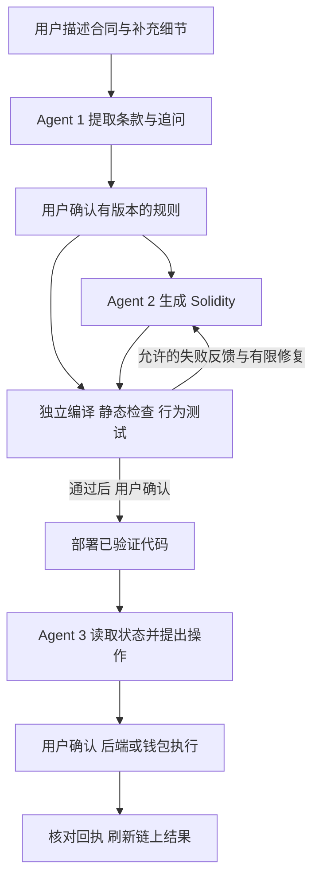

# 让合同条款决定执行逻辑

2026-11-19 规划稿。核对起点为 `d825388`，分支为 `integration/agent2-agent3-local`。本次只整理设计，以下 v2 字段、接口和能力尚未实现。当前可运行版本继续保留。

## 1. 要做成什么

用户描述合作约定，Agent 1 整理、追问并保留条款来源。用户确认后，Agent 2 按这份约定生成合约。独立工具检查该合约是否符合约定。部署后，Agent 3 根据这份合约实际具备的操作帮助用户使用。

不同合同可以规定不同的验收方式、付款时间、修改流程和退出权。此前讨论的“Bob 申请、Alice 确认开工”和“任一方终止后续未开工阶段”保留为一种可选约定，仅在合同包含并明确确认这些条款时采用。它们不作为所有合同的默认规则。

先扩展服务类里程碑付款合同，同一种付款逻辑可以用于设计、软件开发、翻译等服务。按小时计费、租赁押金、多方分账等涉及新的金额计算或权利关系，需要各自补齐执行和验证能力。改变行业名称不等于支持一种新的付款逻辑。

适应性主要来自对条款的理解、澄清和规则组合。系统仍须准确知道条件如何判定、操作由谁授权、结果如何验证。无法判断的付款前提保留在草稿并解释缺口。

## 2. 当前哪些东西固定了

| 位置 | 当前限制 | 改造方向 |
| --- | --- | --- |
| `shared/schemas/handoff.schema.json` | 规则固定为客户验收、无退款、无期限 | 并行新增 v2 规则格式，表达动作、角色、条件和资金效果 |
| `agent1/stub.py` | 返回样例，尚未真实理解合同 | 实现多轮澄清，标记原文与规则的对应关系 |
| `agent2/prompts.py` | 提示词固定全额预存、顺序付款，禁止时间和退款 | 通用安全约束保留，具体付款路径取自确认规则 |
| `flows/generation.py` | 固定装入 v1 接口并调用 v1 验证器 | 根据明确的接口版本选择生成与验证路径 |
| `agent3/` | 固定识别查询、存款、验收 | 按每个项目经验证的操作清单选择动作 |
| `backend/server.cjs` | 固定读取和调用 v1 函数，客户账户签名 | 按接口版本读取状态、编码操作，加入服务方身份 |
| 网页 | 可对话，但补充文字只在浏览器保存，未进入生成规则 | 服务端保存完整草稿，确认卡展示真实可执行条款 |

当前 Agent 2 → 验证 → 本地部署 → Agent 3 已接通。上述固定条件仍限制了合同变化范围。

## 3. 新的连接方式

Node 继续管理项目、确认、版本、部署和交易。Python 继续处理 Agent 和 LangGraph 流程。前端只调用 Node。现有组件逐步增加 v2 分支，不另建一套后端。

## 4. 三个 Agent 分别改什么

### Agent 1 理解约定并解决缺项

每一条影响付款的规则至少说明以下内容。

| 内容 | 示例 |
| --- | --- |
| 原文与来源 | 合同第 4 条，或用户第 3 次补充 |
| 谁可以操作 | 客户验收，服务方提交或领取 |
| 条件 | 已存款、前一阶段完成、本阶段已提交、验收期已到 |
| 资金结果 | 向约定服务方支付当前阶段的未支付金额 |
| 时间依据 | 最新一次有效提交的链上时间，加五个自然日 |
| 冲突与例外 | 客户按时提出修改意见后暂停领取，重新提交后重新计时 |

需要追问的例子包括“五天从何时开始”“自然日还是工作日”“提出修改意见后怎么处理”“交付由谁记录”。不能默认每份合同都包含超时领取，也不能从“验收期五天”自行推导“沉默即验收”。

网站质量、入住事实等链外事实，需要约定由谁确认或使用哪个真实证据来源。上传文件只能证明有一份提交，不能自动证明质量合格。外部来源、签名和异议处理尚未接入时，相关付款条件保留为未解决事项。

建议保留现有三种结果 `needsClarification`、`unsupported`、`readyForConfirmation`。每条付款条件都关联一个规则或一个未解决事项。独立链下义务保留并说明执行范围，影响付款却无法判定的条件阻止确认。已经发现的缺口不能因下一轮对话而消失。

用户确认的是完整规则版本。任何影响资金的修改都必须展示差异并重新确认。Agent 1 不代替用户确认，也不宣布合同在法律上有效。

### Agent 2 按规则生成实际分支

生成输入包含确认规则、匹配的固定合约接口和公共安全要求。角色、触发条件、时间和效果进入生成的 Solidity 控制逻辑。修复期间保持确认规则不变。

第一轮 v2 继续使用构造参数 `(client, provider, amounts)`。业务条件和时间常量写入生成的代码，避免通过增加一组构造参数开关，把所有案例变成同一通用合约。金额仍由构造参数传入，避免把样例金额写死。

固定接口规定操作名称、参数、返回值和事件。不同合同对同一操作的前提可以不同，这些前提来自规则。v1 接口继续原样保留，v2 新增独立接口。新增接口在用于正式实验前冻结。

LangGraph 的生成、独立验证和有限修复顺序保留。生成器只提供源码，验证报告由可信工作流直接取得。通过报告关联当前规则、源码、编译产物和验证版本，随后才能部署。

### Agent 3 按当前合同的操作清单行动

每份通过验证的合同附带一份操作清单。清单由可信适配器根据确认规则和经过检查的接口形成，再由独立验证核对相应行为。模型不能自行批准一个新函数。

清单描述操作 ID、显示名称、允许角色、参数类型、读写类型和对应函数签名。当前能否执行由后端结合链上状态计算。前端按钮和 Agent 3 使用同一份清单。

例如，明确验收合同不提供超时领取。包含沉默期领取条款的合同可以提供领取操作，并显示尚需等待多久、是否正在修改。达到期限后仍须由有权领取的人发起交易。

模型选择操作 ID 和必要的阶段等参数。后端确定可信地址、收款方、金额与调用数据。用户确认前展示实际操作和资金影响，确认时重新核对角色、网络、合约、规则版本及最新状态。操作身份发生变化时，旧计划失效。

所有付款权限、阶段条件、期限和防重复支付也必须在合约内部执行。直接绕过网页调用合约时，这些条件仍应成立。后端检查用于减少误操作，最终执行结果由合约决定。

当前代码只有客户签名。v2 本地演示增加客户与服务方两个测试账户。Sepolia 接入由张嘉豪负责，页面切换角色本身不构成钱包授权。每份操作计划单独编号并绑定发起地址，避免两方互相覆盖计划。

## 5. 模块交接什么

下表为拟议结构。准确字段、必填项和函数签名在第一步接口交付中定稿，本次不改变可执行 schema。

| 交接对象 | 拟议内容 | 权威来源 |
| --- | --- | --- |
| `DraftRulesV2` | 原文、消息历史、角色、阶段、条款规则、原文引用、问题、超范围事项 | Agent 1 提议，服务端保留每次修改 |
| `ConfirmedRulesV2` | 完整规则、项目与修订号、规则内容 hash | 服务端在用户明确确认后固定 |
| `SourceBundle` 与验证报告 | 源码及 hash、规则 hash、接口版本、编译设置、检查结果、产物、操作清单 | Agent 2 提供源码，验证模块提供检查与产物 |
| `DeploymentRecord` | 网络、合约地址、部署交易、规则版本及 hash、源码 hash、ABI、操作清单 | 实际部署后由后端记录 |
| 操作计划与回执 | 计划 ID、操作人、操作 ID、参数、资金效果、部署身份、交易状态 | 后端构建并保存，链上回执确认结果 |

规则可表达为“角色 + 动作 + 条件 + 效果”。条件使用明确类型，如角色匹配、阶段状态、阶段依赖、相对时间和 `allOf` / `anyOf` 组合。效果从记录提交、记录修改意见、支付阶段款等已实现能力中组合。每种类型都有确定含义及独立测试，不接受模型传入任意 Python、JavaScript 或命令作为条件。

规则草稿可以保留尚未支持的约定。可执行格式只接受目前能编码、操作和验证的类型与组合。新增一项通用能力后，可以供多份合同复用，无需按每份合同新增一个分支。任意新型条件仍需扩展能力，不能只凭 JSON 合法就宣称可执行。

## 6. 第一组必须产生不同结果的合同

使用两份金额、参与方和阶段完全一致的协议，仅改变验收条款。下列细节是用于开发的合成样例，将明文写进样例合同。它们不作为其他用户合同的默认值。

| 条款 | 样例 E 明确验收 | 样例 T 沉默期领取 |
| --- | --- | --- |
| 交付记录 | 服务方提交当前阶段 | 服务方提交当前阶段并开始计时 |
| 客户明确验收 | 支付该阶段款 | 支付该阶段款 |
| 客户一直无回应 | 款项继续托管 | 满五个自然日后服务方可主动领取 |
| 客户提出修改意见 | 待重新提交，款项继续托管 | 到期前提出则停止此次领取资格，待重新提交 |
| 重新提交 | 仅在已提出修改意见时允许 | 仅在已提出修改意见时允许，并开始新一轮五天计时 |

样例 T 的五天按 432000 秒计算，起点为有效提交交易所在区块的时间。到期前可以提出修改意见，到期时及之后可以领取。客户也可明确验收，验收与领取只允许其中一笔支付成功。没有修改请求时，重复提交不能重设计时器。

两份样例均约定首次提交前不能验收。提出修改意见后进入待重交状态，此时不能验收或领取，必须等服务方有效重交后恢复验收。这些前提一并写入样例原文和行为表。

两个样例继续使用一次全额存款、按阶段顺序推进、每笔本金只付一次。第一步不引入退款、分账结算或小时计费。缺少这些能力的真实合同保留在草稿，不能悄悄删掉其条件。

建议的 v2 接口增量为提交、提出修改意见、服务方领取，以及读取阶段状态与有效提交时间。例如 `submitMilestone(id)`、`requestRevision(id)`、`claimMilestone(id)`，具体事件、错误和返回类型在第一步固定。两份样例共用同一 v2 接口，E 的领取操作明确不可用且调用会拒绝。

第一组验收覆盖未到期、恰好到期、过期、错误角色、跳阶段、重复提交、修改后旧期限到期、重新提交后的新期限，以及验收和领取两种执行顺序。E 等到第六天仍不能领取，T 在无异议时能够领取。这里比较的是链上状态和实际资金变化。

## 7. 检查如何适应不同合同

| 检查 | 继续负责什么 | 需要新增什么 |
| --- | --- | --- |
| 编译与接口检查 | 源码能编译，函数与事件符合约定 | 按 v1 / v2 选择对应的固定接口 |
| Slither | 对源码做静态安全分析 | 继续沿用固定的阻断标准，业务条款变化不会让 Agent 自行改检测器 |
| 通用行为检查 | 授权、正确收款方与金额、防重复支付、转账失败回滚、重入 | 覆盖新增状态变化与服务方身份 |
| 条款行为检查 | 实际执行是否符合该份规则 | 从独立维护的测试组件组合出时间、修改、付款等用例及交互序列 |

同一段错误代码必须被能区分条款的测试抓住。例如把 E 错写成五天后可领取，或把 T 错写成永远要客户批准，两种情况都应失败。新增组合也要检查条件冲突、无法退出的状态和资金重复处理，不能只测单个功能。

本金记账需守恒，已支付和已退款不得超过实际入账的本金。强行转入的额外 ETH 单独处理，不能被当作客户已存款，也不能因此破坏正常本金核对。

生成器不能为自己的输出创建一套更宽松的评分标准。验证负责人从确认规则和独立预期结果制定测试。Agent 1 另用原文与标准规则检查，防止读错合同后生成、测试一起沿着错误理解通过。

`validation/` 和 `REVIEW.md` 仍由 Claude 维护。我们先提供接口、样例和预期行为，待验证能力交付后才开启相应规则的部署入口。通过现有 24 条 v1 开发检查不能证明新规则已经正确。

## 8. 分阶段交付与完成标准

每一步一个可独立核对和回退的提交或 PR。下一步使用前一步明确版本的接口。

| 顺序 | 本步交付 | 完成标准 |
| --- | --- | --- |
| 1 | 在 `shared/` 新增 v2 草稿、确认规则、操作清单格式与 E/T 样例，新增独立合约接口草案 | Python 与 Node 能校验相同数据。草稿可保留未知规则和缺失条件，确认规则必须拒绝这些缺口。版本混用被拒绝，v1 样例继续通过 |
| 2 | Agent 2 支持 v2 规则生成，Claude 同步提供独立 v2 验证 | 手动确认样例后，两份生成代码表现不同，允许的修复不改规则，尚不开放网页部署 |
| 3 | 后端与 Agent 3 接 v2 操作清单，增加本地服务方签名，网页显示操作与确认卡 | 本地完成 E 的明确验收和 T 的超时领取，读取回执与实际收款，并验证未授权与重复操作被拒绝 |
| 4 | Agent 1 接真实对话、来源与缺项处理，网页提交完整草稿给服务端 | 从两段原文分别得到 E/T 规则，经用户确认走完同一条生成与操作流程 |
| 5 | 逐项扩展合同能力 | 优先交付截止日及其明确约定的退款，再补可选开工确认、未开工退出、双方结算。每项都有原文、规则、接口、正反行为测试和操作说明 |
| 6 | 持久化、Sepolia 和可替换模型入口 | 项目重启可恢复，钱包签名与公开回执可核对，模型适配器能替换 API 模型并通过同一格式与行为检查 |
| 7 | 固定实验版本，接批量 A/B/C 运行与汇总 | 相同数据和条件比较，报告条款通过率、关键支付错误、编译与部署率、Slither 变化、修复次数、token、费用与耗时 |

第 4 步的 Agent 1 可在第 1 步格式固定后并行开发。第 6 步的模型适配和 Sepolia 设计也可并行准备，实际接入以稳定接口为准。微调不作为完成前五步的前置条件。

建议人员接点沿用用户已定分工。徐露源负责 Agent 1，张嘉豪与王嘉豪负责 Agent 2，朱湘怡负责 Agent 3，张嘉豪负责集成和 Sepolia。独立验证代码由 Claude 维护，最终评分的人类负责人另行确认。

## 9. 保留旧版本与回退

- v1 的 schema、`IMilestoneEscrow.sol`、`MilestoneEscrow.sol` 和 `TwoStageEscrow.sol` 保留。新版单独建文件，按项目的明确版本选择适配器。
- 当前 `ConfirmedSpec.schemaVersion=1`、交接 `interfaceVersion=1`、网页 Project `schemaVersion=2` 含义不同。规划中的规则 v2、交接 v2、新网页响应版本分别命名和校验，不能把现有 Project v2 误当作新合同规则。
- v2 入口开发完成后显式启用，旧项目保持原有行为。未知版本报错，禁止自动降低版本、丢字段或回到旧付款规则。
- 已部署合约绑定原始规则、源码与操作清单。编辑草稿不能改变该地址的执行规则，新规则必须重新确认、验证与部署。已有资金留在原合约，不能因版本升级而自动迁移。
- 先记录旧版可演示的提交，每一步单独提交。关闭 v2 后仍可使用 v1。若 v2 已部署，回退应用代码不会撤销链上交易，应继续保留对应的读取与操作适配器。
- 在本地功能阶段以测试账户验证两种角色。转入 Sepolia 后仅用测试钱包和测试币，私钥不进入模型、日志或 Git。

## 10. 规则变化与实验变化分开记录

A 为单次生成，B 获得编译与 Slither 的修复反馈，C 再获得开发条款测试反馈。三组使用相同的确认规则、模型、初始提示词、接口版本和最终评分测试。B/C 最多三次修复，每份协议每组独立运行三次。

最终评分数据、预期结果和测试在正式运行前固定，不进入训练、提示词调整或修复。Agent 1 的规则提取单独评分，全流程示例另外显示错误来自理解、生成还是操作。微调模型与原模型另行比较，不能把模型不同混成修复反馈的效果。

正式指标分别汇报不同条款类型和组合的结果。仅修改标题、金额或行业名称的案例，不能单独证明付款逻辑有适应性。相似原文的改写样本不能同时进入开发数据和最终测试数据。

## 11. 本轮结束点与下一步

本轮交付为这份设计、入口链接和工作日志。没有更改运行接口、Agent、合约、前后端或验证代码。

下一步只实施表中的第 1 步。先交付两份条款不同的样例、v2 数据格式及接口约定，让三个模块使用同一份明确规则。开工、退款与结算继续作为各份合同可选择的约定，不再为单一网站案例制定全产品统一的付款规则。
